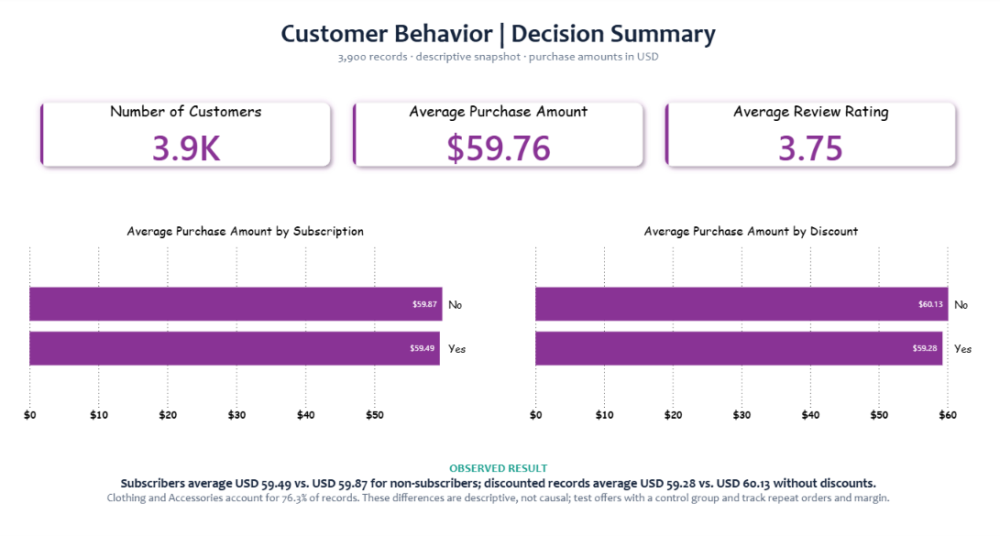
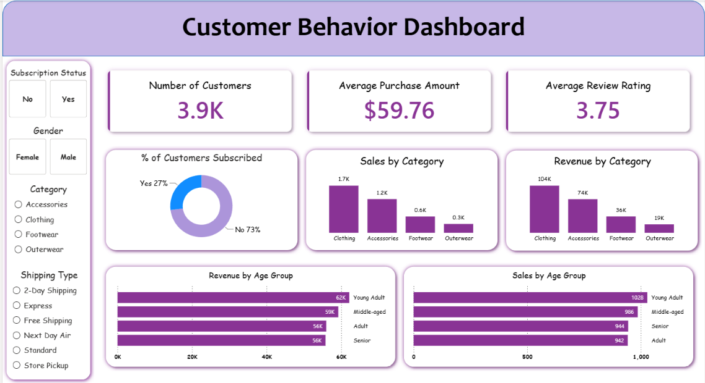

# Customer Behavior Analytics

An end-to-end analysis of a customer shopping dataset using Python, MySQL, and Power BI. The notebook cleans and enriches the source CSV, the SQL file answers business questions, and the Power BI report presents the results.

## Project files

- `customer_shopping_behavior_1.csv` — source dataset (3,900 rows).
- `customer-trends-data-analysis.ipynb` — data checks, cleaning, feature creation, and MySQL/Excel exports.
- `customerAnalysis.sql` — database setup and analysis queries.
- `Customer_Behavior_Dashboard_Summary.pbix` — Power BI report with the interactive dashboard and **Decision Summary** page.
- `docs/data_dictionary.md` — field descriptions and analysis limitations.
- `docs/analysis_summary.md` — findings, recommendations, and data limitations.
- `docs/decision_summary_screenshot.png` — uploaded screenshot of the Decision Summary page.
- `docs/interactive_dashboard_screenshot.png` — uploaded screenshot of the interactive dashboard.

## Power BI report

The report opens on the interactive dashboard. Its **Decision Summary** page has cards for customer count, average purchase amount, and average review rating; charts comparing average purchase amount by subscription and discount status; and a conclusion callout with the category share and recommended controlled test.

The report's semantic model uses the `Sheet1` table and its existing measures. The notebook creates `customer_shopping_behavior_1.xlsx` in the project folder, which is the model's data source. Refresh the report after creating or updating the workbook. If you move the project folder, update the workbook path in the report's data source settings before refreshing.

## Power BI screenshots

Open `Customer_Behavior_Dashboard_Summary.pbix` in Power BI Desktop to see the interactive dashboard first, then select **Decision Summary** for the outcome-focused page.

### Decision Summary



### Interactive dashboard



## Run the analysis

1. Install Python 3.10 or newer and MySQL 8.0 or newer.
2. From the project directory, install the Python dependencies:

   ```powershell
   python -m venv .venv
   .\.venv\Scripts\Activate.ps1
   python -m pip install -r requirements.txt
   ```

3. In MySQL Workbench or the MySQL CLI, run the database setup at the top of `customerAnalysis.sql`. This creates and selects the `customer_behavior` database.
4. Set the connection variables in your shell. Keep real credentials out of notebooks and source control:

   ```powershell
   $env:DB_USER = "your_mysql_user"
   $env:DB_PASSWORD = "your_mysql_password"
   $env:DB_HOST = "127.0.0.1"
   $env:DB_PORT = "3306"
   $env:DB_NAME = "customer_behavior"
   ```

5. From the same PowerShell session where you set the database variables, start the notebook from the project directory:

   ```powershell
   jupyter lab customer-trends-data-analysis.ipynb
   ```

   Run the notebook from top to bottom. Its database export replaces the `customer` table each time it runs.
6. Run the analysis queries in `customerAnalysis.sql`. The notebook creates `customer_shopping_behavior_1.xlsx` in the project folder. Open `Customer_Behavior_Dashboard_Summary.pbix` in Power BI Desktop and refresh the report.

## Notes on interpretation

Each row represents one recorded purchase/customer record in this dataset, and every customer ID appears once. The file has no transaction date, order ID, or repeated customer history. Treat `purchase_amount` as the amount on the recorded row, not lifetime customer revenue. The data supports descriptive comparisons, but it does not support time trends, retention, cohort analysis, or causal claims. See the data dictionary for additional details.

## Project conclusion

In this 3,900-record snapshot, subscribers do not have a higher average recorded purchase amount than non-subscribers ($59.49 vs. $59.87), and discounted records average less than non-discounted records ($59.28 vs. $60.13). These comparisons do not show cause and effect. The defensible recommendation is to test subscription benefits and discounts with a control group while collecting repeat orders and margin data. Clothing and Accessories account for 76.3% of records, so they are useful categories to monitor in the next analysis. See the [analysis summary](docs/analysis_summary.md) for the detailed evidence and recommendations.
